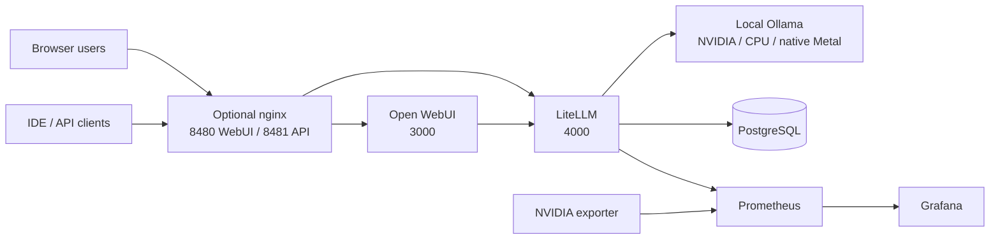

# PocketMind

Local OpenAI-compatible LLM stack for Windows 11, macOS Apple Silicon, and Ubuntu/Linux. It combines chat, a model API, local inference and monitoring in one repository.

## Architecture



- `default-general` (`qwen3:4b-instruct-2507-q4_K_M`) is the initial text model.
- `default-ocr` (`scb10x/typhoon-ocr1.5-3b`) is the initial Thai/English OCR model.
- Model Lab registers additional local models with your chosen aliases.
- Docker volumes keep models, accounts, chats, API keys and monitoring state on each host.

`auto` chooses native Ollama on macOS, NVIDIA when the Docker GPU probe succeeds on Windows/Linux, otherwise CPU. See [architecture](docs/architecture.md) for request paths, persistence and trust boundaries.

## Start here

Install Docker/Compose and follow the [provisioning guide](docs/provisioning-guide.md) for host prerequisites, credentials and administrator setup. On a new Linux/macOS host, from the cloned repository:

```bash
./scripts/provision.sh --AdminEmail you@example.com --CheckOnly
./scripts/provision.sh --AdminEmail you@example.com
```

Windows and manual profile instructions are in [Getting started](docs/getting-started.md). Once installed, open Open WebUI at `http://localhost:3000`; shared proxy access uses `http://<server-ip>:8480` when enabled.

For an **existing server**, follow [Updating a server](docs/server-update.md). Keep the private `.env` and named volumes; do not copy `.env.example` over existing credentials or tuning.

## Documentation

Start with the [Documentation index](docs/README.md), or choose the task:

- [Install a new server](docs/provisioning-guide.md) · [Platform/profile setup](docs/getting-started.md)
- [Update without losing configuration](docs/server-update.md) · [Tune GPU, context and concurrency](docs/tuning.md)
- [Ports, firewall and proxy](docs/network-access.md) · [Daily operations](docs/operations-runbook.md)
- [Add/remove models](docs/models/manage-models.md) · [API keys and IDEs](docs/api-access.md)
- [WebUI accounts and OCR](docs/open-webui.md) · [Monitoring](docs/monitoring.md)
- [Privacy and controlled model downloads](docs/privacy.md) · [Security](docs/security.md)
- [Backup and restore](docs/backup-and-restore.md) · [Troubleshooting](docs/troubleshooting.md)

The CPU/NVIDIA base stack publishes backend ports on all interfaces by default; restrict client access. Privacy mode changes this to loopback backends and an internal network after models/caches are prepared. Enterprise deployment also needs Infra egress policy, HTTPS and endpoint controls; configuration alone does not guarantee data cannot leak.

Platform verification limits are recorded in [Getting started](docs/getting-started.md#validation-scope) and the [deployment checklist](docs/server-deployment-checklist.md). Historical implementation plans under `docs/superpowers/` are not current operating instructions.
