# ADR 0006: Optional Governed Model Import with MuleSoft

- Date: 2026-10-28
- Status: Accepted by the user for implementation (2026-10-28), including the administrator automation amendment
- Implementation: Stage A synthetic POC and management adapters implemented; Stage B enterprise integration and Stage C live qualification pending
- Amendment: 2026-10-28 — administrator requests once; automated delivery through user availability with a durable progress view
- Plan: [Implementation plan](../superpowers/plans/2026-10-28-governed-model-import.md)

## Context

PocketMind must remain usable through multiple deployment paths. Adding an organizational MuleSoft integration must not turn MuleSoft into a mandatory dependency or replace the existing local inference stack. Standalone users must retain their existing setup, direct model downloads, model aliases, API keys and monitoring.

Today `scripts/model-lab.ps1 add` pulls an Ollama model and registers a database-backed LiteLLM alias. Ordinary Compose also uses model-init to pull initial models. Privacy mode instead checks locally available models, uses internal backend networking and disables online features. There is no automated artifact approval store, model scanner, trusted release manifest or governed importer. Existing security documentation describes approval requirements but does not enforce them.

The organization wants a serving server with Internet egress denied, while MuleSoft controls requests for externally sourced models. The existing MuleSoft deployment type, entitlement, network locations, scanner and artifact storage are not yet known. This decision defines interfaces and boundaries without assuming those services already exist.

## Decision

Add an optional governed model acquisition and import path. Preserve `Open WebUI -> LiteLLM -> local Ollama` as the inference path. MuleSoft governs acquisition requests and orchestration; separate workers download and inspect artifacts before an approved release is made available internally.

The following are mandatory compatibility constraints:

1. Standalone commands and default Compose selection remain unchanged.
2. Missing MuleSoft configuration never affects standalone startup, inference or model management.
3. Existing Privacy mode remains supported without MuleSoft. Governed import must not require disabling Privacy mode.
4. Existing models, stable aliases, credentials and persistent volumes are not migrated or replaced automatically.
5. Governed operations fail closed; failure must never fall back to a public download.
6. Governance on a managed deployment is enforced by infrastructure and privileged service boundaries, not merely an optional CLI flag.

### Deployment choices

| Choice | Model acquisition | Serving |
|---|---|---|
| Standalone | Existing direct pull workflow | Existing CPU, NVIDIA or native profile |
| Isolated serving | Previously prepared/imported local artifacts | Existing Privacy mode; CPU/NVIDIA only |
| Governed acquisition and import | MuleSoft request API, quarantine, approval, internal release | Privacy mode on the organizational serving server |

Governance is an acquisition capability, not a new GPU/runtime profile. Native users keep their existing workflow. Governed native import is outside the first release and must return an explicit unsupported-profile error before making changes.

### Administrator experience and automation

The target is one administrator request, not a manual handoff at every architectural hop. An optional administrator interface accepts source (Ollama or Hugging Face), model identifier or recognized provider link, version/quantization, alias, target server, intended user group and purpose. The backend normalizes recognized links into validated provider identifiers; it is not an arbitrary URL fetcher. The administrator does not need to find a commit hash or copy files between systems: the acquisition worker resolves immutable identity and records it.

After submission, a durable workflow automatically performs preflight, download, quarantine, scans, policy evaluation, release publication, internal transfer, local verification, installation, smoke testing, alias registration and the requested access grant. `ready` means the requested group can discover and use the model, not merely that a download finished. An end-to-end script exposes the same workflow for the initial POC and automation clients; the admin interface submits to the same API and reads the same job state.

Preflight checks source/format support, runtime compatibility, disk space, configured resource limits and target/group authorization before expensive download. Existing compatible approved artifacts can be reused after current approval/revocation checks. Unsupported models stop with an actionable reason; arbitrary Hugging Face models are not automatically supported just because the source is supported.

Approval normally occurs automatically under a versioned policy configured in advance by the organization's policy owner. The workflow records the evaluated evidence, policy identity/version and approval decision. `awaiting_approval` is an exception for a new license/publisher or another reviewable policy exception, not a mandatory human click for every request. Missing scanner coverage, tampering or failed mandatory checks cannot be bypassed with an approve button; they require remediation and a new validated attempt. Human exception decisions require an authorized reviewer distinct from the requester. Neither the requesting admin nor the acquisition worker may edit policy or fabricate passing evidence to approve its own job.

Each job has a persistent checklist: `preflight`, `resolve`, `download`, `scan`, `policy`, `publish`, `transfer`, `verify`, `install`, `smoke_test`, `register`, `grant_access`. Steps expose `pending`, `running`, `succeeded`, `failed`, `blocked` or `skipped`, timestamps, attempt count and sanitized error/action. Progress reports bytes/total where known and otherwise an indeterminate state, never invented percentages. The admin view shows the current step and waiting reason; the model's end users do not need these implementation details.

Retries use bounded backoff for transient failures. Checkpoints and idempotency survive client disconnects, worker restarts and status-page closure. A host-side management agent claims target-specific approved jobs through authenticated internal polling, reports leases/heartbeats and performs import without opening inference-container egress. A durable coordinator owns job state; scripts and the UI do not keep it only in process memory. Cancellation is cooperative at safe checkpoints, does not delete shared artifacts or existing models and records any completed side effects. Retry/resume and cancel are authenticated audited operations. Installing the agent and configuring policy/credentials/firewall are one-time deployment tasks, not per-model tasks.

Automatic user availability applies only to the explicitly requested authorized group and the new alias, using existing Workspace Model/read-grant conventions. It never grants everyone access, overwrites default aliases or expands previously issued API keys. Users may issue a new appropriately scoped key through the existing mechanism. If access provisioning fails, keep the model unavailable to the requested group and show a retryable failed step; do not label the job `ready`.

### Target state

```mermaid
flowchart LR
    Admin[Admin interface or one-command script] -->|request once / progress| Mule[MuleSoft acquisition API]
    Mule --> Jobs[Durable job orchestrator]
    Sources[Hugging Face / Ollama sources] --> Worker[Download worker in acquisition zone]
    Jobs --> Worker
    Worker --> Quarantine[Quarantine storage]
    Quarantine --> Checks[License / integrity / format scans / isolated evaluation]
    Checks --> Approval[Approval authority]
    Approval --> Releases[Immutable approved repository]
    Releases -->|verified bundle over approved management path| Importer[Management-side importer]
    Importer --> Ollama[Local Ollama]
    Importer --> LiteLLM[Alias registration in LiteLLM]
    Jobs -->|approved target jobs via internal polling| Importer
    Importer --> Grants[Requested group access in Open WebUI]
    Importer -->|step results and receipt| Jobs
    UI[Open WebUI / API clients] --> LiteLLM
    LiteLLM --> Ollama
```

Arrows for artifact delivery describe data movement, not a blanket firewall permission. Infrastructure must specify which side initiates each connection. No acquisition worker mounts production data, chats, backups, secrets or the Docker socket of the serving host.

### Packaging and network boundaries

- Provide host-invoked management scripts as reusable building blocks and a host-side agent for unattended delivery. The agent is an explicitly installed OS service/scheduled worker with least necessary local privileges; it calls local management APIs and never gives the acquisition host Docker administration access.
- Package the optional admin interface/coordinator in a separate Compose project, provisionally `compose.governance.yml` with a distinct project name and volumes. Do not silently include it in existing setup commands or attach it to `ai-net`. Production coordination can instead implement the same durable API in the organization's integration platform.
- A separate project avoids removal by the existing serving setup's `up --remove-orphans`. It must not share container names with PocketMind or mount the Docker socket.
- Keep quarantine and downloader/scanner services on the acquisition host. An acquisition-side Compose project, if supplied for POC, must be explicitly labelled for that host and synthetic data.
- The serving host, Docker forwarding paths, nginx edge and IPv4/IPv6 require Internet default-deny. Explicit internal DNS, management and artifact-transfer permissions are infrastructure work.
- Ollama remains on the existing internal serving network. The importer invokes its local management interface from the host; it does not add an external network to Ollama or the other backends.
- Preferred transfer: approved internal repository through an allowed management path. If only MuleSoft may be contacted, MuleSoft must expose approved releases with resumable transfer; qualify size/timeouts separately. Neither path exposes arbitrary upstream URLs.

### Acquisition API contract, version 1

The endpoint names below are proposed repo-owned contracts for a MuleSoft implementation, not existing MuleSoft product endpoints.

- `POST /model-acquisitions`: authenticated request containing `source` (`huggingface` or `ollama`), `model_id`, requested revision/tag and artifact selection, `purpose`, `alias`, `target_id` and `access_group_id`; an `Idempotency-Key` header prevents duplicate acquisition jobs. The backend resolves immutable identity. Reject arbitrary URLs; recognized provider links are normalized before this API is called. Return HTTP 202 with `job_id` and status URL.
- `GET /model-acquisitions/{job_id}`: return overall state, current step, persistent checklist/progress, sanitized failure/action, target, alias and, only when approved, an immutable `release_id`. Do not return provider credentials or signed upstream URLs.
- `POST /model-acquisitions/{job_id}/retry` and `/cancel`: authorized audited lifecycle operations; retries preserve linked attempts and completed safe checkpoints. Define agent claim/heartbeat/result endpoints in the implementation contract with target-bound authorization, leases and fencing against stale workers.
- `GET /model-releases/{release_id}/manifest`: authenticated, approved release manifest. Artifact transfer uses the approved internal repository or an explicitly configured MuleSoft release endpoint.
- Overall job states: `requested -> running -> ready`, with explicit `awaiting_approval`, `rejected`, `failed` and `cancelled` states. The checklist records detailed stage state. Release approval is a separate artifact lifecycle (`quarantined`, `approved`, `rejected`, `revoked`), so an approved release never implies installation or user readiness. Approval requires complete passing evidence and a recorded versioned policy decision or authorized exception review as defined above. Re-scan/retry creates a new attempt with linked audit history. Revocation prevents future imports.
- Persist job/approval history outside gateway process memory. API authentication, authorization, TLS, credential storage and audit retention are configured by the organization.
- Resolve source tags to immutable identities before approval. Hugging Face uses a full commit hash; Ollama records the source manifest digest and every referenced blob digest. A tag alone is not an approved identity.
- Download workers validate source identifiers, redirects and resolved destinations against policy, including private/link-local/metadata addresses. They must not become an arbitrary URL fetch or SSRF service.

### Approved release and importer contract

Version 1 targets a supported single-file GGUF plus reviewed Modelfile/template metadata and a local Ollama destination. Source adapters may acquire from either provider, but must produce this same normalized bundle. Ollama adapters preserve source manifest/blob evidence and license/template information; a raw Ollama volume copy is not an approved bundle. Split GGUF, vision projectors, arbitrary Safetensors conversions and new inference engines need explicit later compatibility work. Downloadability does not establish runtime compatibility, including for the DeepSeek model discussed earlier.

A release manifest records `schema_version`, immutable `release_id`, source publisher/model/revision/digests, license identifier and retained license files, target runtime and qualified version, relative file paths/sizes/SHA-256 values, scan results/coverage/tool versions, evaluation evidence, approval identity/time, policy version and revocation status reference. Record conversion tool/version/input/output digests if conversion occurred.

The trusted manifest must come from the authenticated approval authority; a manifest bundled beside attacker-controlled files is not sufficient authority. For the first increment, import requires online approval/revocation verification through the configured internal API over validated TLS. Offline signed approval is a later feature requiring organization-owned keys and a revocation-freshness policy. No approval credentials or trusted key are taken from the downloaded bundle.

The importer must:

1. Validate schema, current approval, intended runtime and the entire bundle before model creation. Reject missing/duplicate/unlisted files, unsupported schema, unsafe paths, symlinks, hash/size mismatch and missing approval evidence. Scanner errors, unsupported mandatory coverage and skipped scans cannot become passing results.
2. Stage verified files under operator-owned permissions; prevent concurrent modification between verification and use. Do not execute downloaded scripts. Build a Modelfile from restricted reviewed metadata, with `FROM` pointing only at the verified local GGUF, never a public model name or URL.
3. Create a release/alias-specific physical model name without overwriting an existing model. No public `pull` is executed. Preserve license text and append a manifest-hash provenance marker in local model license metadata. If an earlier create response/receipt was lost, reconcile only when both the provenance marker and the approved source blob digest match the local model; otherwise fail with a conflict. Confirm local model creation and perform a synthetic inference check.
4. Register a new custom alias using existing LiteLLM conventions only after successful checks. Do not overwrite `default-general`, `default-ocr`, an existing alias or existing model weights. The workflow then provisions the explicitly requested authorized Workspace Model/group read grant automatically and verifies discoverability; it does not broaden existing API key scopes.
5. Write a durable, secret-free import receipt linking release, artifact hashes, local physical name, alias, test result and operator. On alias-registration failure leave verified weights unexposed and report remediation; never delete a shared or pre-existing model automatically.

The importer's approval check is a deployment gate, not per-request inference enforcement. Revocation stops future imports; stopping a model already serving requires the incident runbook to revoke access/remove aliases and unload it deliberately. The first release does not claim automatic runtime revocation.

### Security and operational scope

Gateway prompt/response policies do not scan weights. Scanner coverage must explicitly include format and file size. A clean scan does not prove absence of malicious model behavior or runtime vulnerabilities. Evaluate artifacts in an isolated worker before promotion and use synthetic inputs for the serving smoke check.

Keep source credentials on acquisition infrastructure. Keep API credentials outside Git and command arguments/logs. Import authority is privileged: host administrators, Docker administrators or holders of the LiteLLM master key can bypass application guards. Restrict these through management access/PAM and audit.

Container images, embedding/tokenizer/reranker/audio caches, runtime binaries and dependencies also require approved preparation. The first model-import increment does not implement a universal package mirror. Missing dependencies must fail clearly without reopening public egress.

## Alternatives considered

| Approach | Tradeoff | Decision |
|---|---|---|
| MuleSoft orchestrates; separate worker/storage/importer | Additional components, but clear quarantine and scalable file transfer | Selected |
| Download and scan every model synchronously inside Mule flows | Large transfer, storage, timeout and resume coupling; still needs qualified scanners | Not the default; qualify separately if mandated |
| Forward proxy with destination allow-list only | Helps control destinations but provides no immutable artifact approval gate | Insufficient alone |
| Replace LiteLLM/inference with MuleSoft | Expands scope and makes an optional integration mandatory | Outside this decision |

## Consequences

The repository gains optional management scripts, contracts, tests and documentation, not a mandatory cloud service. The implemented Stage A uses Python 3.11+ standard library/SQLite for shared orchestration and validation, PowerShell entrypoints and an optional server-rendered UI/Compose project. A real MuleSoft account is unnecessary for fixture checks. Fixtures demonstrate software behavior only; they are not production approval or security certification. See the [governance runbook](../governance.md) and [delivery ledger](../../governance/IMPLEMENTATION.md) for current usage and evidence.

Organizational rollout requires a real acquisition API, persistent jobs, an approved scanner with sufficient coverage, artifact storage, approval authority, trusted TLS and network controls. A stub that returns `approved` cannot satisfy these requirements. Production governance must not be advertised until those controls have been deployed and verified.

## Acceptance and scope protection

- Existing standalone setup/model management and Privacy contracts pass without governance configuration or MuleSoft connectivity.
- Turning on governance is explicit; malformed/partial settings fail only governed commands and never trigger fallback.
- Pending, rejected, failed, revoked, tampered, unsupported and partially transferred releases cannot create a model or alias.
- Import does not call public registries, change backend network attachments, overwrite production aliases or expose management APIs through nginx.
- A trusted approved compatible fixture can be imported, smoke-tested and registered without Internet access, with a receipt and predictable restart behavior.
- Real rollout proves direct external access denied, approved internal access allowed, scanning/approval failures blocked, audit persistence and offline chat/API/restart behavior.
- A single request automatically reaches `ready` for an eligible compatible artifact, including verified access for the requested group, without per-stage admin commands. Progress and checkpoints survive client disconnect and worker/coordinator restart; retries do not duplicate models or grants.
- Inference gateway changes, cloud fallback, SSO redesign, automatic replacement of default models, a generic forward proxy and additional runtime support require a separate ADR or explicit amendment. Automated installation of a new approved alias and its requested group grant are explicitly in scope.

## Unresolved deployment inputs

MuleSoft product/runtime/entitlements; on-premises versus cloud routing; IdP and service authentication; internal storage; scanner format/size coverage; policy for supported GGUF artifacts; approval/audit retention owner; exact serving OS/runtime versions; maximum release size and concurrency. These block production qualification, not local contract and fixture development. Resolve them before implementing provider-specific deployment assets.

## References

- [Existing privacy boundary](../privacy.md) and [model approval boundary](../security.md#model-approval-and-execution-boundaries).
- [MuleSoft Model Proxy](https://docs.mulesoft.com/general/model-proxy) and [policies](https://docs.mulesoft.com/general/model-proxy-policies): inference governance, separate from artifact inspection.
- [Mule HTTP streaming](https://docs.mulesoft.com/http-connector/latest/http-request-ref): transport needs qualification for large artifacts.
- [Ollama local import](https://docs.ollama.com/import) and [proxy configuration](https://docs.ollama.com/faq#how-do-i-use-ollama-behind-a-proxy).
- [Hugging Face revision pinning](https://huggingface.co/docs/huggingface_hub/en/guides/download#from-specific-version) and [malware scan size scope](https://huggingface.co/docs/hub/security-malware).
